<h2 align="center">GovConnect </h2>

<p align="center">
  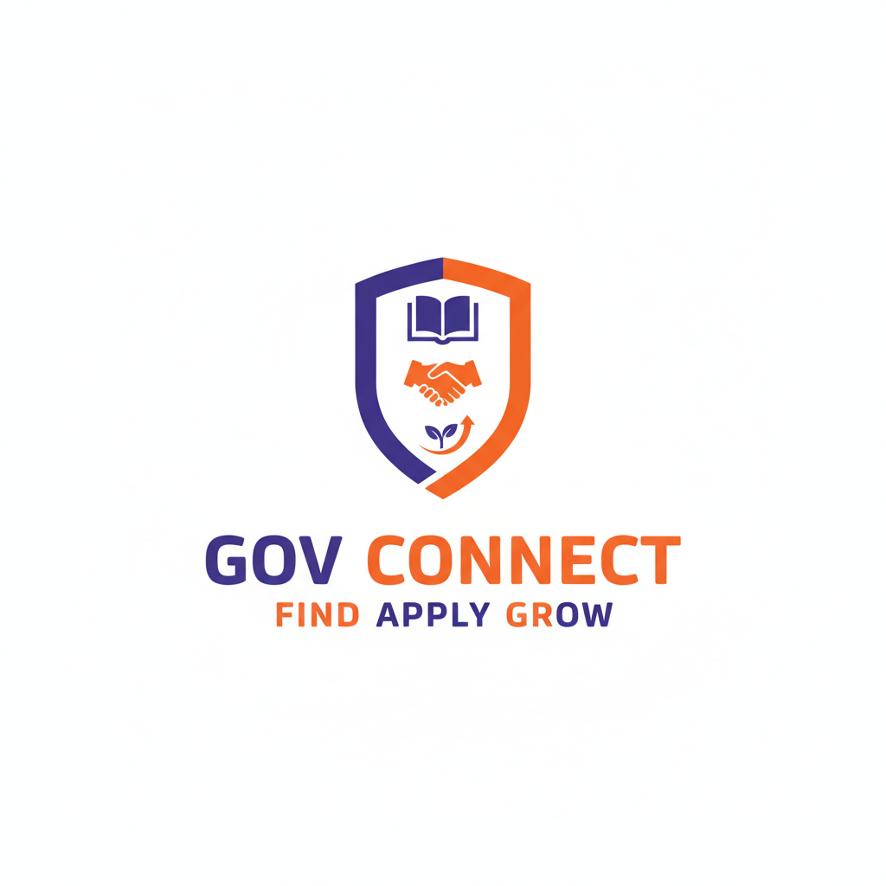
</p>

<h1 align="center">Discover Opportunities.<br>Build Your Future.</h1>

<p align="center">
  An AI-powered mobile platform that connects students and job seekers with opportunities that match their ambitions.
</p>

<p align="center">
  
  
  
  
  
  
</p>

<p align="center">
  <a href="#features">Features</a> &nbsp;·&nbsp;
  <a href="#screenshots">Screenshots</a> &nbsp;·&nbsp;
  <a href="#technology">Technology</a> &nbsp;·&nbsp;
  <a href="#setup">Setup</a>
</p>

---

<p align="center">
  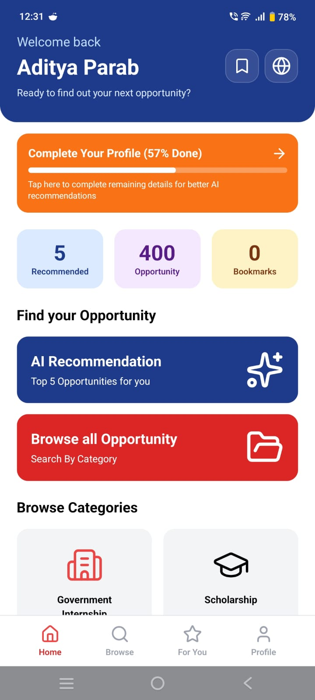
  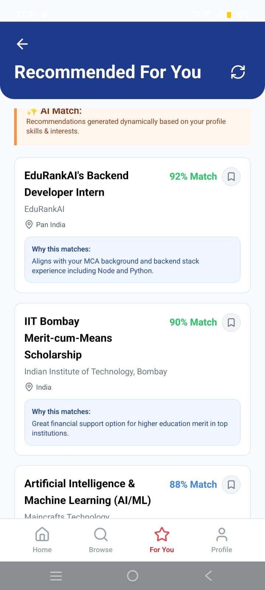
  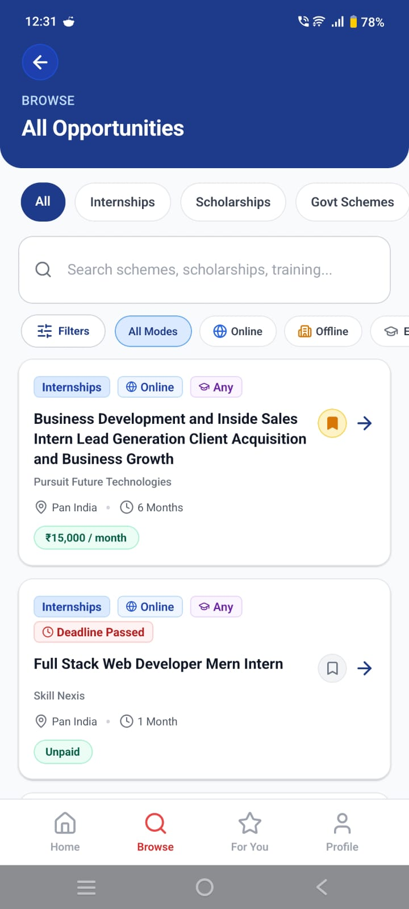
</p>

<p align="center">
  <b>One platform. Multiple possibilities.</b>
</p>

---

## The Idea

Finding the right opportunity should not mean searching dozens of websites.

GovConnect brings scholarships, internships, government schemes, and skill-development programs together in one mobile application. By combining resume parsing with AI-powered recommendations, GovConnect helps users discover opportunities that align with their skills, qualifications, interests, and career goals.

## Features

<table>
  <tr>
    <td width="50%">
      <h3>01 / Resume Intelligence</h3>
      Upload a resume and extract relevant skills, education, and profile information using AI.
    </td>
    <td width="50%">
      <h3>02 / Personalized Discovery</h3>
      Explore opportunities with AI-generated match percentages and recommendation explanations.
    </td>
  </tr>
  <tr>
    <td width="50%">
      <h3>03 / Opportunity Explorer</h3>
      Browse internships, scholarships, government schemes, and skill-development programs.
    </td>
    <td width="50%">
      <h3>04 / Smart Filtering</h3>
      Search and filter opportunities by category, eligibility, keywords, and mode.
    </td>
  </tr>
  <tr>
    <td width="50%">
      <h3>05 / Personal Profile</h3>
      Maintain your skills, qualifications, interests, and career preferences.
    </td>
    <td width="50%">
      <h3>06 / Saved Opportunities</h3>
      Bookmark interesting opportunities and keep track of their deadlines.
    </td>
  </tr>
</table>

## Screenshots

### Opportunity Discovery

<p align="center">
  
  
</p>

<p align="center">
  <sub>Explore opportunities and discover what's relevant to you.</sub>
</p>

### Personalized Recommendations

<p align="center">
  
</p>

<p align="center">
  <sub>AI-powered recommendations based on your profile.</sub>
</p>

### Explore Opportunities

<p align="center">
  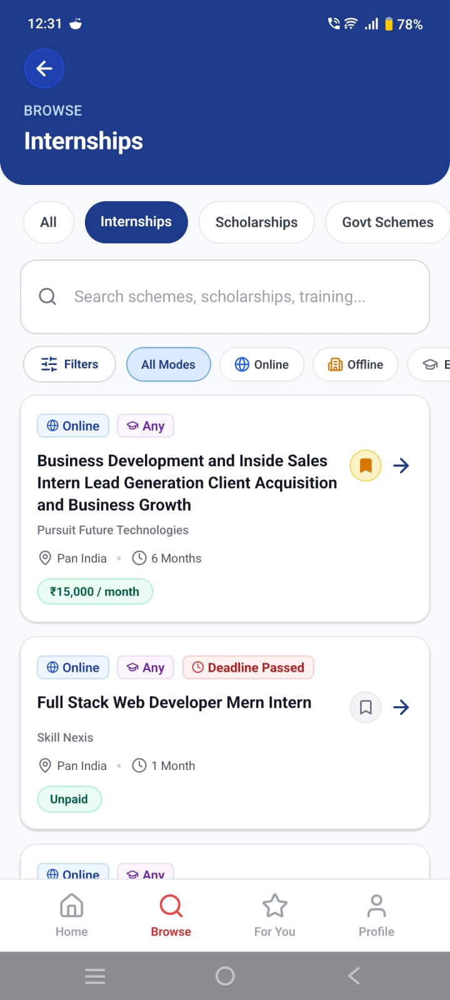
  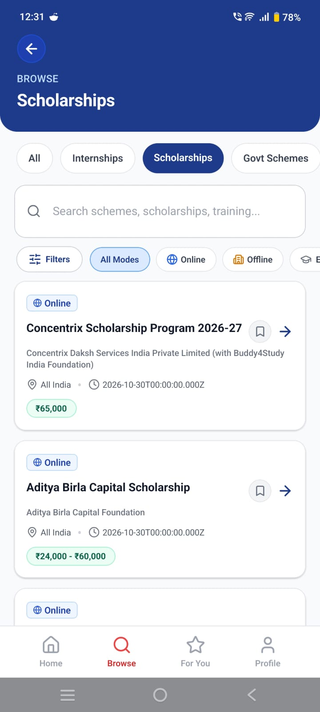
  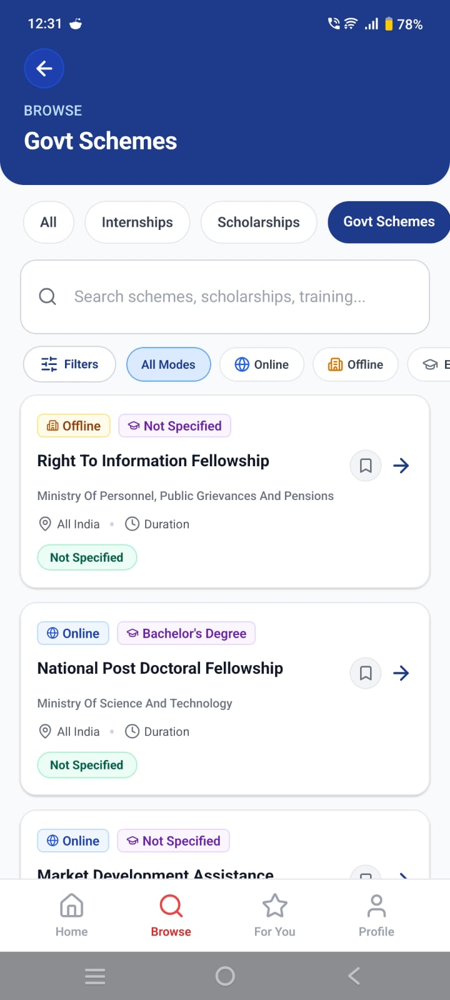
  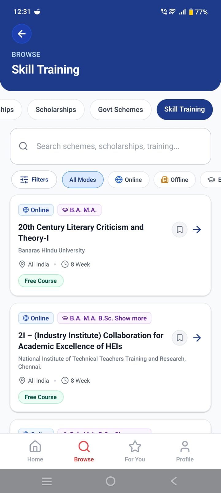
</p>

<p align="center">
  <sub>Internships · Scholarships · Government Schemes · Skill Training</sub>
</p>

### Resume and Profile

<p align="center">
  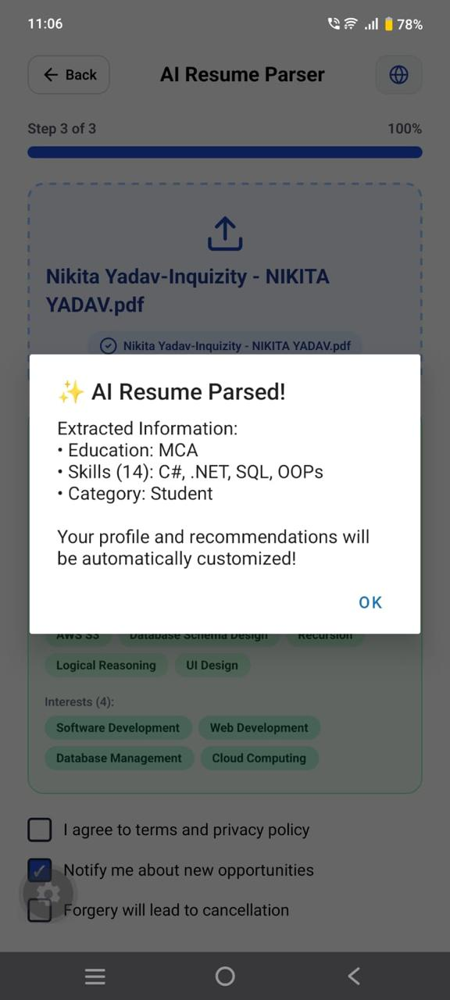
  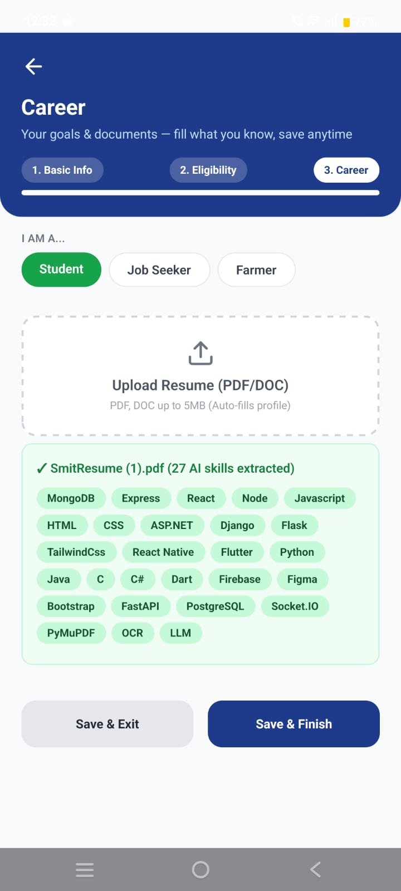
  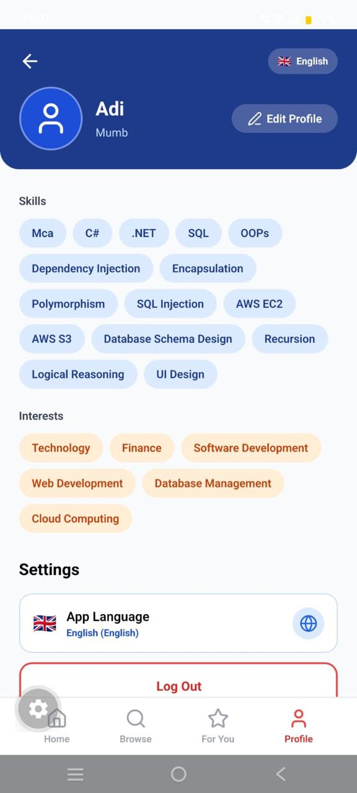
</p>

### Bookmarks and Language Selection

<p align="center">
  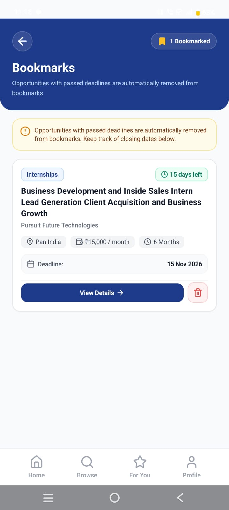
  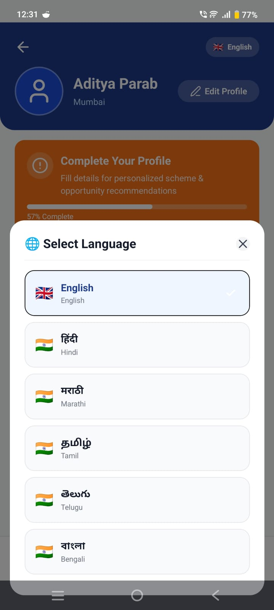
</p>

## Technology

<p align="center">
  
  
  
  
  
  
  
</p>

| Technology | Purpose |
|---|---|
| React Native & Expo | Mobile application development |
| Node.js & Express.js | Backend and REST API |
| MongoDB Atlas | Database |
| Google Gemini API | Resume parsing and personalized recommendations |
| Puppeteer | Opportunity data collection |

## How It Works

<p align="center">
  
  
  
  
</p>

1. Users register or sign in using OTP authentication.
2. Users complete their profile and upload a resume.
3. The resume parser extracts skills and qualifications.
4. The application generates personalized opportunity recommendations.
5. Users explore, filter, and bookmark relevant opportunities.

## Project Structure

```text
GovConnect/
├── client/       # React Native application
├── server/       # Node.js and Express backend
├── assets/       # README screenshots
└── README.md
```

## Setup

### Prerequisites

- Node.js and npm
- Expo Go or an Android development environment
- MongoDB Atlas account
- Google Gemini API key

### Installation

**Clone the repository**

```bash
git clone https://github.com/adieeeADI/GovConnect.git
cd GovConnect
```

**Start the backend**

```bash
cd server
npm install
npm start
```

Configure the required environment variables in your backend `.env` file.

**Start the mobile application**

Open a new terminal:

```bash
cd client
npm install
npx expo start
```

Follow the Expo instructions to run the application on your device or emulator.

## Future Scope

- Expand the opportunity database and improve data coverage.
- Improve recommendation accuracy and personalization.
- Enhance accessibility and user experience.
- Extend support for additional languages.


<p align="center">
  <b>GovConnect</b><br>
  <sub>Connecting people with opportunities.</sub>
</p>
